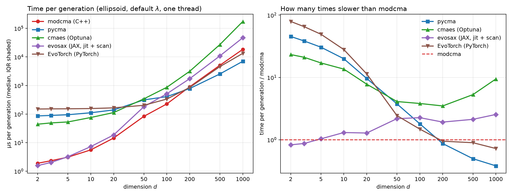
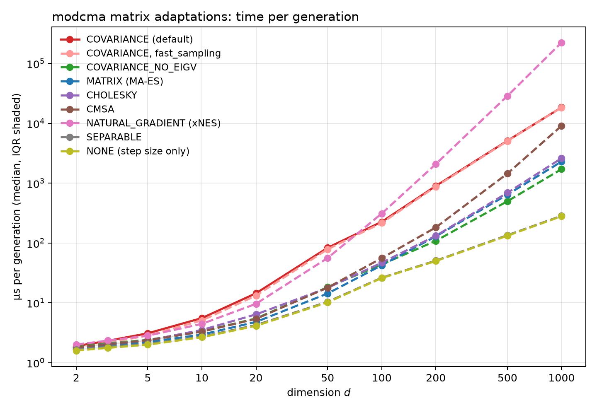
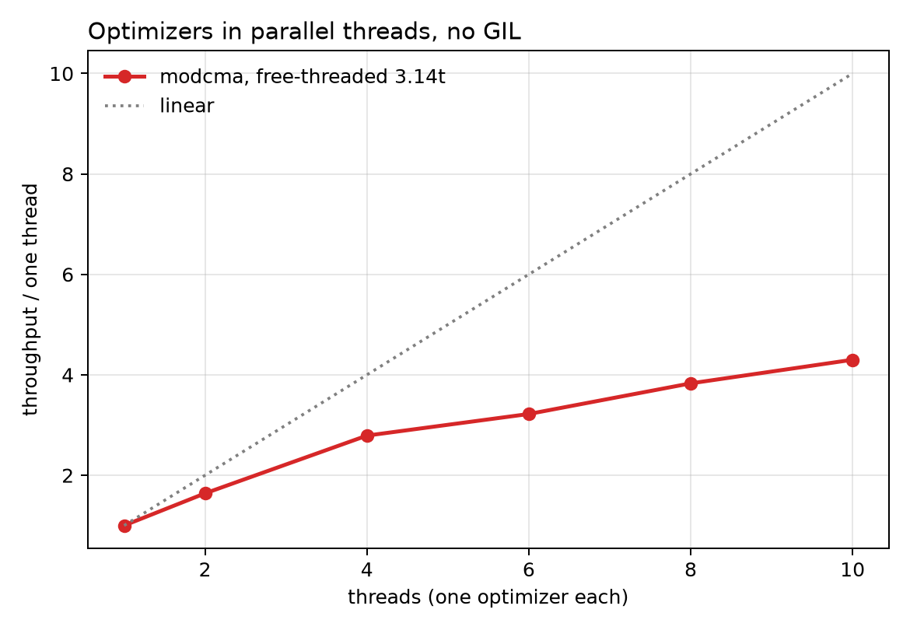

# Performance

How fast is ModularCMAES compared with other CMA-ES implementations, and how do its matrix
adaptations scale with the dimension?

**In short.** Up to d = 10, ModularCMAES runs a generation **20–45× faster than pycma**,
**14–23× faster than `cmaes`** (the implementation in Optuna) and **28–79× faster than EvoTorch**;
at d = 100 it is still 1.5–3.8× faster than each of them. It matches evosax, even when evosax
compiles the *entire* run into one XLA program, and is twice as fast from d = 50. Above d ≈ 200 the default
covariance update spends its time in the eigendecomposition, where pycma's LAPACK is faster (see
[Limits](#limits)); the matrix adaptations that do not need an eigendecomposition (MA-ES,
Cholesky-CMA-ES, …) stay ahead of every other implementation up to d = 1000. On free-threaded
Python, independent optimizers run in parallel threads.



## Contents

- [Setup](#setup)
- [CMA-ES implementations](#cma-es-implementations)
- [ModularCMAES matrix adaptations](#modularcmaes-matrix-adaptations)
- [Python objectives: vectorized and ask–tell](#python-objectives-vectorized-and-asktell)
- [Parallel threads](#parallel-threads)
- [Where the speed comes from](#where-the-speed-comes-from)
- [Limits](#limits)
- [Reproducing](#reproducing)

## Setup

| | |
|---|---|
| Machine | Apple M5 (4 performance + 6 efficiency cores), 16 GB, macOS 27 |
| Python | 3.13.15; free-threaded 3.14.7t for [threads](#parallel-threads) |
| Versions | modcma (this repository), pycma 4.6.0, cmaes 0.13.1, evosax 0.3.2 (JAX 0.12.1), EvoTorch 0.6.1 (PyTorch 2.15.0), numpy 2.5.5 |
| Problem | separable ellipsoid f(x) = Σᵢ 10^(6(i−1)/(d−1)) xᵢ², d = 2 … 1000 |
| Algorithm | each library's full-covariance CMA-ES: population size λ = 4 + ⌊3 ln d⌋, σ₀ = 2, m₀ = 0, no restarts, no active update |
| Measurement | wall time of a fixed number of generations (1000 for d ≤ 100, 200 above), median of 15 runs (5 above d = 100), IQR shaded in the figures |
| Threads | one: BLAS/OpenMP, XLA and torch are limited to one thread, so the comparison is between implementations, not thread pools |

Every library evaluates the whole population with one call to the same ellipsoid, written for its own
array type (numpy, JAX, torch). Evaluating it costs well under a microsecond per point, so the time
per generation is the algorithm: sampling, selection and the updates of the mean, step size and
covariance matrix, plus the library's overhead per generation. Each library is driven the way its
documentation recommends:

| | how it is run |
|---|---|
| modcma | `ModularCMAES.run(f, vectorized=True)`: the loop runs in C++, one Python call per generation |
| pycma | `ask()` / `tell()` |
| cmaes | `ask()` once per solution, `tell()` (its interface) |
| evosax | `ask` / `tell` of `CMA_ES`, the **whole run** compiled with `jax.jit` + `jax.lax.scan` (compilation excluded): JAX's best case |
| EvoTorch | `CMAES.step()` on a vectorized `Problem` |

## CMA-ES implementations

Time per generation (median):

| implementation | d=2 | d=10 | d=50 | d=100 | d=200 | d=500 | d=1000 |
|---|---|---|---|---|---|---|---|
| **modcma** | **1.9 µs** | **5.6 µs** | **83 µs** | **226 µs** | **899 µs** | **5.1 ms** | **18.4 ms** |
| pycma | 86 µs | 111 µs | 313 µs | 407 µs | 781 µs | 2.5 ms | 7.0 ms |
| cmaes (Optuna) | 44 µs | 76 µs | 341 µs | 864 µs | 3.1 ms | 27.1 ms | 174.2 ms |
| evosax (JAX, jit + scan) | 1.6 µs | 7.3 µs | 181 µs | 512 µs | 1.7 ms | 10.9 ms | 47.0 ms |
| EvoTorch (PyTorch) | 150 µs | 156 µs | 203 µs | 335 µs | 853 µs | 4.6 ms | 13.3 ms |

How many times longer each library takes than modcma (above 1: modcma is faster):

| | d=2 | d=10 | d=50 | d=100 | d=200 | d=500 | d=1000 |
|---|---|---|---|---|---|---|---|
| pycma | **45×** | **20×** | 3.8× | 1.8× | 0.9× | 0.5× | 0.4× |
| cmaes (Optuna) | **23×** | **14×** | 4.1× | 3.8× | 3.5× | 5.3× | 9.4× |
| evosax (JAX, jit + scan) | 0.8× | 1.3× | 2.2× | 2.3× | 1.9× | 2.1× | 2.5× |
| EvoTorch (PyTorch) | **79×** | **28×** | 2.4× | 1.5× | 0.9× | 0.9× | 0.7× |

* In low dimension the Python libraries pay a fixed overhead per generation: about 85 µs for pycma,
  45 µs for cmaes and 150 µs for EvoTorch, which is more than a whole modcma generation up to d ≈ 20.
  A run of 10 000 generations at d = 10 takes 0.06 s with modcma and 1.1 s with pycma.
* evosax only matches modcma when the objective is itself written in JAX and the whole run is one
  compiled program. With an objective outside JAX (a simulator, a Python function) every generation
  goes back to the host, and evosax pays its per-call overhead like the other Python libraries.
  modcma has no compilation step and the same speed for any objective.
* Above d ≈ 200, pycma (and EvoTorch at d = 1000) overtake the default `COVARIANCE` update: see
  [Limits](#limits).

## ModularCMAES matrix adaptations



| matrix adaptation | d=2 | d=10 | d=50 | d=100 | d=200 | d=500 | d=1000 |
|---|---|---|---|---|---|---|---|
| **COVARIANCE (default)** | **1.9 µs** | **5.6 µs** | **83 µs** | **226 µs** | **899 µs** | **5.1 ms** | **18.4 ms** |
| COVARIANCE, `fast_sampling` | 1.8 µs | 5.1 µs | 79 µs | 216 µs | 876 µs | 5.0 ms | 18.3 ms |
| COVARIANCE_NO_EIGV | 1.8 µs | 3.3 µs | 18 µs | 44 µs | 109 µs | 499 µs | 1.7 ms |
| MATRIX (MA-ES) | 1.7 µs | 3.0 µs | 14 µs | 42 µs | 129 µs | 644 µs | 2.3 ms |
| CHOLESKY | 1.8 µs | 3.5 µs | 18 µs | 47 µs | 132 µs | 691 µs | 2.6 ms |
| CMSA | 1.8 µs | 3.3 µs | 18 µs | 56 µs | 182 µs | 1.4 ms | 9.1 ms |
| NATURAL_GRADIENT (xNES) | 2.0 µs | 4.4 µs | 56 µs | 311 µs | 2.1 ms | 28.7 ms | 224.0 ms |
| SEPARABLE | 1.6 µs | 2.7 µs | 10 µs | 26 µs | 51 µs | 135 µs | 285 µs |
| NONE (step size only) | 1.6 µs | 2.7 µs | 10 µs | 26 µs | 50 µs | 132 µs | 280 µs |

* The cost per generation follows the update: O(d²λ) for MA-ES, Cholesky-CMA-ES and the
  Cholesky-based `COVARIANCE_NO_EIGV`, O(d³) for the eigendecomposition of the default (amortized
  over several generations) and for the matrix exponential of `NATURAL_GRADIENT` (every generation),
  and O(dλ) for `SEPARABLE` and `NONE`.
* MA-ES, Cholesky-CMA-ES and `COVARIANCE_NO_EIGV` are level with the fastest other implementation
  (evosax) at d ≤ 3 and faster than every other implementation from d = 5 to d = 1000, where they
  are **3–4× faster than pycma** (1.7–2.6 ms vs 7.0 ms). They are different algorithms, though, not
  a faster default.
* `fast_sampling` (xoshiro256++ and a ziggurat instead of mt19937 and the inverse normal CDF; a
  different random stream, so off by default) saves up to 10 % here; for the cheap adaptations, where
  sampling dominates, it halves the time (the [C++ benchmark](bench/bench.cpp): `SEPARABLE`,
  d = 100, 19.9 → 10.2 µs per generation).

## Python objectives: vectorized and ask–tell

A Python objective is called by C++ once per point, unless it takes the whole population:

```python
cma.run(lambda X: np.sum(X**2, axis=1), vectorized=True)   # X is (λ, d)
```

| objective | d=2 | d=10 | d=50 | d=100 | d=200 | d=500 | d=1000 |
|---|---|---|---|---|---|---|---|
| vectorized (one call per generation) | **1.9 µs** | **5.6 µs** | **83 µs** | **226 µs** | 899 µs | 5.1 ms | 18.4 ms |
| one call per point | 5.7 µs | 13 µs | 95 µs | 235 µs | 879 µs | 5.1 ms | 18.5 ms |

Vectorized evaluation is 2–3× faster in low dimension, where the Python call (about 0.7 µs per
point) is most of the work. The same holds for the ask–tell interface (`ask()` returns the
population as a `(λ, d)` array, `tell(f)` takes the values): an objective evaluated outside the
optimizer, in parallel or on another machine, costs one round trip per generation, and the results
are bit-identical to `run()`.

## Parallel threads

Every optimizer has its own random generator, and the extension does not re-enable the GIL on
free-threaded CPython (3.14t). Independent optimizers can therefore run in parallel threads of one
process (here d = 10, ellipsoid, one optimizer per thread):



| threads | generations/s | speed-up |
|---|---|---|
| 1 | 175,755 | 1.00× |
| 2 | 288,637 | 1.64× |
| 4 | 491,025 | 2.79× |
| 6 | 566,334 | 3.22× |
| 8 | 673,441 | 3.83× |
| 10 | 756,239 | 4.30× |

With the GIL (regular CPython 3.14) the same 10 threads reach 1.00×. The M5 has 4 performance and
6 efficiency cores, so the curve flattens after 4 threads.

## Where the speed comes from

* **No allocation per sample.** The population lives in preallocated buffers; sampling, selection,
  recombination and the updates write into them. 0.05–0.15 heap allocations per evaluation remain
  (13–25 before).
* **Matrix products instead of loops.** A generation is sampled as one product Y = A·Z; the
  covariance matrix gets symmetric rank updates on its lower triangle; `C^-1/2` is never formed.
* **One crossing per generation.** With a vectorized objective or ask–tell, Python is called once
  per generation, not once per point; bindings with nanobind.
* **Lazy eigendecomposition**, as in pycma: C is decomposed only every few generations (every 3rd
  at d = 200, every 9th at d = 1000).

The C++ benchmark ([`bench/bench.cpp`](bench/bench.cpp), `modcma_bench`) measures the phases of a
generation without Python.

## Limits

* **The default above d ≈ 200.** Both modcma and pycma decompose C about equally often (66 times in
  200 generations at d = 200, 22–24 times at d = 1000), but one eigendecomposition with Eigen's
  `SelfAdjointEigenSolver` takes about 165 ms at d = 1000, against 48 ms for LAPACK's `dsyevd`
  (Apple Accelerate, one thread) that pycma calls through numpy. A LAPACK backend for the
  eigendecomposition would close this gap; it would add a BLAS/LAPACK dependency to the build.
* **One thread per optimizer.** modcma does not parallelize the linear algebra of a single
  optimizer; numpy, JAX and torch can use several threads for large matrices, which would favour them
  at d ≥ 500 on a machine with idle cores.
* **Time per generation, not time to solution.** All libraries implement CMA-ES with slightly
  different defaults (learning rates, weights, eigendecomposition interval, evosax and cmaes decompose
  every generation). This document measures cost, not convergence; for convergence see the
  [BBOB comparison](scripts/matrix/bbob_matrix_adaptation.png).

## Reproducing

```bash
python -m venv .venv-bench && source .venv-bench/bin/activate
python -m pip install . -r scripts/performance/requirements.txt
python scripts/performance/benchmark.py probe                  # estimate (seconds)
python scripts/performance/benchmark.py run                    # ~15 minutes on the M5
python3.14t scripts/performance/threads.py                     # free-threaded CPython, modcma installed
python scripts/performance/plot.py                             # figures and results/tables.md
```

Run it on an otherwise idle machine. The raw numbers, with the library versions and the machine of
every run, are in [`scripts/performance/results/`](scripts/performance/results/).
