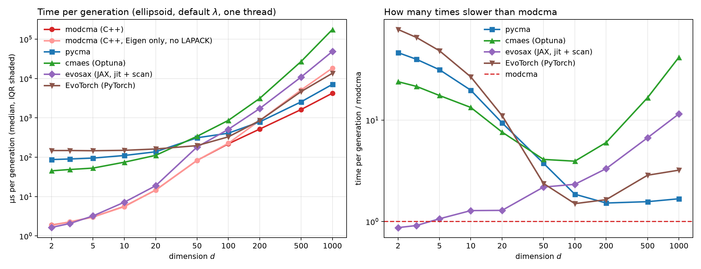

<p align="center">
  
</p>

<p align="center">
  <a href="https://pypi.org/project/modcma/"></a>
  <a href="https://pypi.org/project/modcma/"></a>
  <a href="https://github.com/IOHprofiler/ModularCMAES/actions/workflows/python-package.yml"></a>
  <a href="https://github.com/IOHprofiler/ModularCMAES/actions/workflows/python-publish.yml"></a>
  <a href="https://modularcmaes.readthedocs.io"></a>
  <a href="https://pypi.org/project/modcma/"></a>
</p>

**One CMA-ES, many algorithms.** `modcma` is a fast, modular implementation of the Covariance Matrix
Adaptation Evolution Strategy (CMA-ES) for derivative-free black-box optimization, written in C++
and used from Python. Its modules (the covariance update, step-size adaptation, sampling,
selection, restarts, bound handling, ...) can be switched independently, giving millions of
distinct variants, so the same optimizer is
CMA-ES, IPOP- or BIPOP-CMA-ES, sep-CMA-ES, MA-ES, Cholesky-CMA-ES, xNES,
or any combination in between.

* **Fast**: a generation takes microseconds; up to d = 10, 20–47× faster than pycma and level with
  a fully JIT-compiled JAX implementation, and faster than pycma, `cmaes`, evosax and EvoTorch from
  d = 10 to 1000 ([benchmarks](docs/performance.md)).
* **Ask–tell for every module**, with the same results as `run()`, bit for bit; vectorized
  objectives; parallel threads on free-threaded Python.
* **Ready for experiments**: reproducible seeds per optimizer, restarts and stopping criteria you can
  inspect and replace, integer variables, and a ConfigSpace for algorithm configuration.

## Installation

```bash
pip install modcma
```

Wheels for Linux, macOS and Windows (x86_64 and ARM), CPython 3.10–3.14 and the free-threaded 3.14t.

## Quickstart

```python
import numpy as np
import modcma

def rosenbrock(x):
    return float(np.sum(100 * (x[1:] - x[:-1] ** 2) ** 2 + (1 - x[:-1]) ** 2))

xopt, fopt, evaluations, es = modcma.fmin(rosenbrock, x0=np.zeros(10), sigma0=0.5, budget=20_000)
print(fopt, evaluations)
```

Choose modules by name, as keyword arguments, or on a `Modules` object:

```python
xopt, fopt, evaluations, es = modcma.fmin(
    rosenbrock, x0=np.zeros(10), sigma0=0.5, budget=50_000,
    matrix_adaptation="MATRIX",    # MA-ES
    restart_strategy="BIPOP",      # BIPOP restarts
    active=True,                   # active covariance update
    target=1e-8,
    seed=1,
)

modules = modcma.Modules()
modules.matrix_adaptation = modcma.options.MatrixAdaptationType.SEPARABLE
es = modcma.ModularCMAES(modcma.Settings(10, modules=modules, budget=20_000, seed=1))
es.run(rosenbrock)
print(es.p.stats.global_best)
```

Evaluate the objective yourself, for example in parallel, with ask–tell:

```python
es = modcma.ModularCMAES(modcma.Settings(10, x0=np.zeros(10), sigma0=0.5, budget=20_000, seed=1))
while True:
    X = es.ask()                          # (k, d) array of points
    f = [rosenbrock(x) for x in X]        # evaluate them anywhere
    if es.tell(f) and es.break_conditions():
        break
```

## Speed



Time per generation on the ellipsoid, one thread (Apple M5); details and the other matrix
adaptations in [the benchmarks](docs/performance.md).

## Modules

| module | options |
|---|---|
| matrix adaptation | full covariance (default), MA-ES, separable, Cholesky, CMSA, natural gradient, none |
| step-size adaptation | CSA (default), TPA, MSR, PSR, xNES variants, 1/5th success rule, self-adaptation |
| restarts | none, stop, restart, IPOP, BIPOP; repelling restarts; where to restart |
| selection | active update, elitism, sequential selection, recombination weights |
| sampling | mirrored, pairwise, orthogonal; Sobol and Halton sequences; Gaussian, Cauchy, Laplace, ... mutations; sampled step sizes; threshold convergence |
| bounds | none, saturate, mirror, toroidal, COTN, uniform resampling, resampling |

What each does and when to use it: [the user guide](https://modularcmaes.readthedocs.io/en/latest/guide/modules/).

## Documentation

[modularcmaes.readthedocs.io](https://modularcmaes.readthedocs.io): getting started, the user
guide for every module, examples (multimodal problems, parallel evaluation, BBOB benchmarks, tuning,
mixed-integer problems, coming from pycma), the API reference, and the C++ library. `help()` works
on every class and function.

Upgrading from 1.x: version 2.0 removed the pure-Python implementation (`AskTellCMAES`,
`evaluate_bbob`, `ModularCMAES(func, d)`); see the
[migration guide](https://modularcmaes.readthedocs.io/en/latest/migration/). It remains in
`pip install "modcma<2"` and on the branch
[`legacy-python`](https://github.com/IOHprofiler/ModularCMAES/tree/legacy-python).

## Citation

If you use modcma in your research, please cite the paper that describes the framework (under
review; its arXiv version until it is published):

```bibtex
@misc{denobel2026modcma,
  author        = {de Nobel, Jacob and Vermetten, Diederick and Kononova, Anna V. and Doerr, Carola and B\"{a}ck, Thomas},
  title         = {The Modular {CMA-ES}: A Framework for Modern Evolution Strategies},
  year          = {2026},
  eprint        = {2610.09699},
  archivePrefix = {arXiv},
  doi           = {10.48550/arXiv.2610.09699},
  url           = {https://arxiv.org/abs/2610.09699},
}
```

and, for the study of the modules with algorithm configuration:

```bibtex
@inproceedings{denobel2021,
  author    = {de Nobel, Jacob and Vermetten, Diederick and Wang, Hao and Doerr, Carola and B\"{a}ck, Thomas},
  title     = {Tuning as a Means of Assessing the Benefits of New Ideas in Interplay with Existing Algorithmic Modules},
  booktitle = {Proceedings of the Genetic and Evolutionary Computation Conference Companion},
  series    = {GECCO '21},
  year      = {2021},
  pages     = {1375--1384},
  publisher = {Association for Computing Machinery},
  doi       = {10.1145/3449726.3463167},
}
```

The experiments of the framework paper are reproduced with
[`docs/reproducibility.md`](docs/reproducibility.md).

## Contributing and license

See [`CONTRIBUTING.md`](CONTRIBUTING.md) and the [changelog](CHANGELOG.md). MIT license
([`LICENSE`](LICENSE)).
