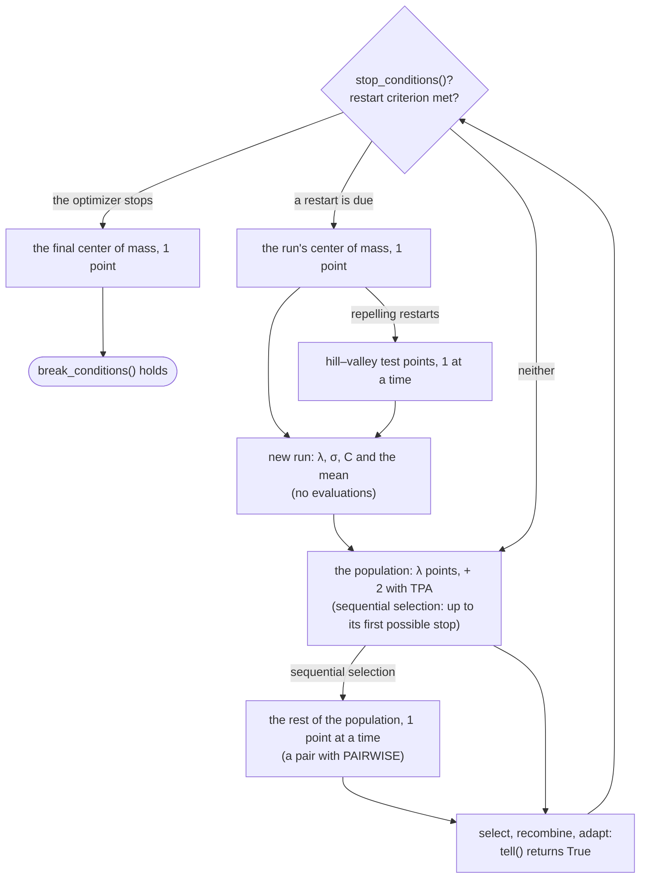

# Ask–tell and vectorized evaluation

`run(func)` calls the objective once per point, from inside the optimizer. Two other ways give
you control over the evaluation: a **vectorized** objective, which evaluates a whole batch in one
call, and **ask–tell**, where you evaluate the points yourself, wherever you like.

## Vectorized objectives

A vectorized objective takes a `(k, d)` array (one point per row) and returns `k` values. It saves a
Python call per point, which matters when the objective is cheap and numpy-friendly:

```python
import numpy as np
import modcma

def sphere_batch(X):
    return np.sum(X**2, axis=1)

es = modcma.ModularCMAES(modcma.Settings(10, budget=10_000, seed=1))
es.run(sphere_batch, vectorized=True)
print(es.p.stats.global_best.y)
```

`step(func, vectorized=True)` does the same for one generation.

## Ask–tell

`ask()` returns the points to evaluate as a `(k, d)` array; `tell(f)` takes their objective values,
in the same order, and returns `True` when it completed a generation. Check the break conditions
after a completed generation. When the optimizer should stop (`es.stop_conditions()`), one more
`ask()` returns the run's center of mass, a single point; `break_conditions()` holds after its
`tell()`. The loop below handles that without a special case:

```python
def sphere(x):
    return float(np.sum(x**2))

es = modcma.ModularCMAES(modcma.Settings(10, budget=10_000, seed=1))
while True:
    X = es.ask()
    f = [sphere(x) for x in X]
    if es.tell(f) and es.break_conditions():
        break
print(es.p.stats.global_best.y)
```

The loop is the same for every configuration, and the results are identical to `es.run(sphere)`
with the same seed, bit for bit:

```python
es_run = modcma.ModularCMAES(modcma.Settings(10, budget=10_000, seed=1))
es_run.run(sphere)
assert es_run.p.stats.global_best.y == es.p.stats.global_best.y
```

### What `ask()` returns

Usually `k` is the population size λ. Some modules ask for other batches:

| configuration | what `ask()` returns |
|---|---|
| default | the λ points of a generation |
| TPA step-size adaptation (`ssa=TPA`) | λ + 2 points: the population and the two TPA test points (`TPA_INPLACE` takes them from the population: λ points). With `elitist`, λ points after a generation whose selection kept every parent (#179) |
| sequential selection | the points up to the first one after which the generation may stop (with TPA, its two points too), then one point at a time (two with pairwise mirroring) |
| at the end of every run: a restart, and when the optimizer stops | the run's center of mass, one point (recorded in `es.p.stats.centers`) |
| repelling restarts | the points of the hill–valley tests, one at a time |

So do not assume `k == λ`: always evaluate the rows of what `ask()` returned. `ask()` returns the
same points until `tell()` is called, so asking twice is harmless. The optimizer can be pickled
between `ask()` and `tell()` too: after loading, `ask()` returns the same points
([saving and resuming a run](../guide/checkpointing.md)).

Behind this, the optimizer runs the fixed steps of a generation. A step that needs evaluations
queues its points, and the generation waits until `tell()` gives their values. The boxes with
points are the batches that `ask()` returns, in this order:



`es.has_pending` tells whether points wait for their values.

### Repaired or injected points

To evaluate other points than the asked ones (after repairing an infeasible point, or to inject a
known good solution) pass them along with their values: `tell(f, X)`. Each row of `X` that differs
from the asked point replaces it in the population.

```python
es = modcma.ModularCMAES(modcma.Settings(5, budget=2_000, seed=1))
X = es.ask()
X[0] = np.zeros(5)  # inject the optimum
es.tell([sphere(x) for x in X], X)
print(es.p.stats.global_best.y)  # 0.0
```

### Gradient injection

With the gradient of the objective, `inject_gradient(g)` replaces one point of a new population by
a point along the negative gradient from the mean ([gradient injection](../guide/gradients.md)).
It is accepted between the `ask()` that starts a population and its `tell()`
(`es.accepts_gradient`); ask again for the points with the gradient point:

```python
def sphere_gradient(x):
    return 2.0 * x

es = modcma.ModularCMAES(modcma.Settings(10, budget=10_000, seed=1))
while True:
    X = es.ask()
    if es.accepts_gradient:
        es.inject_gradient(sphere_gradient(es.center_of_mass))
        X = es.ask()
    if es.tell([sphere(x) for x in X]) and es.break_conditions():
        break
```

This gives the same results as `es.run(sphere, gradient=sphere_gradient)`.

## Parallel evaluation

With ask–tell the batch can be evaluated in parallel, for example in processes:

```python
--8<-- "examples/parallel.py"
```

When the objective releases the GIL (or on free-threaded Python, 3.14t), threads work as well
(`ThreadPoolExecutor`). Independent optimizers can also run in parallel threads: each has its own
random generator ([reproducibility](../guide/reproducibility.md)).
