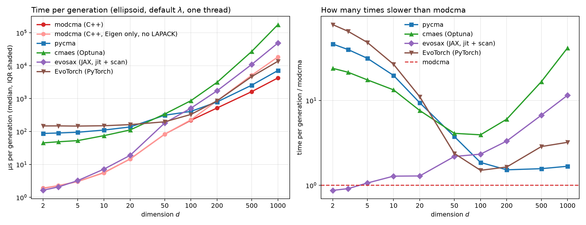

# Modular CMA-ES

**One CMA-ES, many algorithms.** `modcma` is a fast, modular implementation of the Covariance Matrix
Adaptation Evolution Strategy (CMA-ES) for derivative-free, continuous (and mixed-integer)
black-box optimization. It is written in C++ and used from Python. Its modules (the
covariance update, step-size adaptation, sampling, selection, restarts, bound handling, ...) can be
switched independently, so the same optimizer is CMA-ES, IPOP- or BIPOP-CMA-ES, sep-CMA-ES, MA-ES,
Cholesky-CMA-ES, xNES, or any combination in between.

```python
import numpy as np
import modcma

def rosenbrock(x):
    return float(np.sum(100 * (x[1:] - x[:-1] ** 2) ** 2 + (1 - x[:-1]) ** 2))

xopt, fopt, evaluations, es = modcma.fmin(rosenbrock, x0=np.zeros(10), sigma0=0.5, budget=20_000)
print(fopt, evaluations)
```

```bash
pip install modcma
```

Wheels for Linux, macOS and Windows, CPython 3.10 to 3.14, including free-threaded 3.14t.

## Why modcma

<div class="grid cards" markdown>

-   **Modular**

    ---

    Choose the covariance update (`COVARIANCE`, `MATRIX`, `SEPARABLE`, `CHOLESKY`, `CMSA`,
    `NATURAL_GRADIENT`, ...), the step-size adaptation (CSA, TPA, MSR, xNES, ...), restarts
    (IPOP, BIPOP, repelling restarts), active updates, elitism, mirrored and quasi-random sampling,
    and more: millions of distinct variants. Every combination runs; the few that do not fit
    together are adjusted ([compatibility](guide/compatibility.md)).
    [The modules →](guide/modules.md)

-   **Fast**

    ---

    A generation takes microseconds: up to d = 10, 20–47× faster than pycma and level with a
    fully JIT-compiled JAX implementation; faster than pycma, `cmaes`, evosax and EvoTorch from
    d = 10 to 1000. [Benchmarks →](performance.md)

-   **Ask–tell, for every module**

    ---

    Evaluate the objective wherever you like (in parallel processes, on a cluster, in a simulator)
    with `ask()` and `tell()`, or pass a vectorized objective. Every module works, with exactly the
    same results as `run()`. [Ask–tell →](getting-started/ask-tell.md)

-   **Ready for experiments**

    ---

    Reproducible seeds per optimizer, parallel threads on free-threaded Python, a ConfigSpace for
    algorithm configuration, integer variables, warm starts from a related task, gradient
    injection, and restarts and stopping criteria you can inspect and replace.
    [User guide →](guide/modules.md)

</div>



## Where next

* [Installation](getting-started/installation.md) and the [quickstart](getting-started/quickstart.md).
* [Modules](guide/modules.md): what each module does and when to use it.
* [Examples](examples/index.md): multimodal problems, parallel evaluation, BBOB benchmarks,
  tuning, mixed-integer problems, warm starting, and the pycma equivalents.
* [API reference](reference/index.md).
* Upgrading from modcma 1.x? See [migrating from 1.x](migration.md).

If you use modcma in your research, please [cite it](citing.md).
