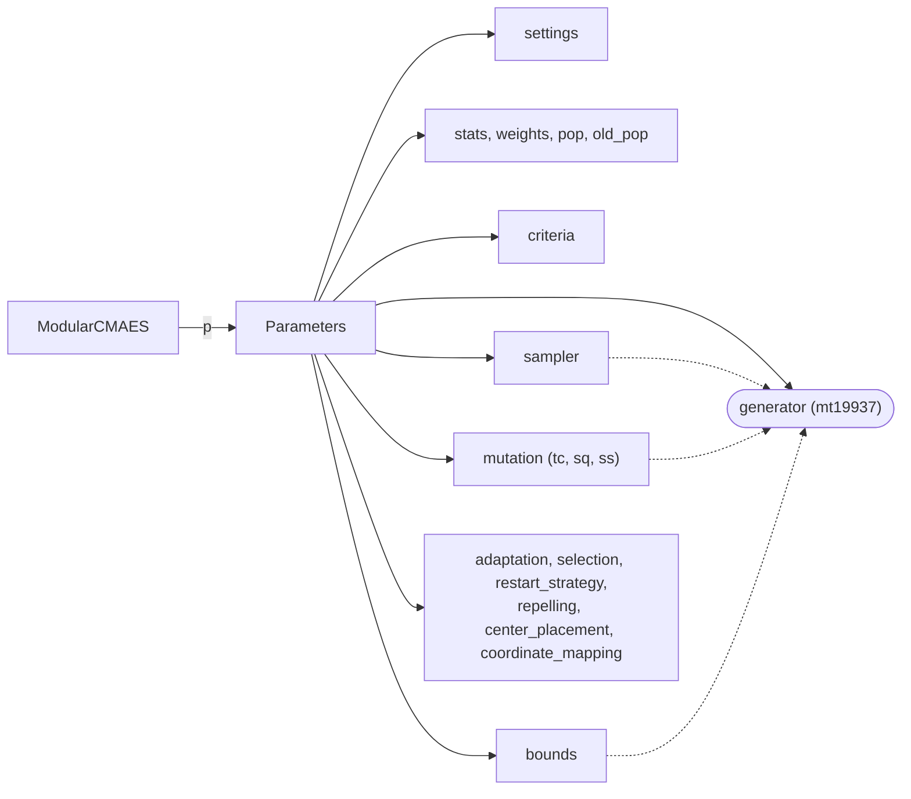
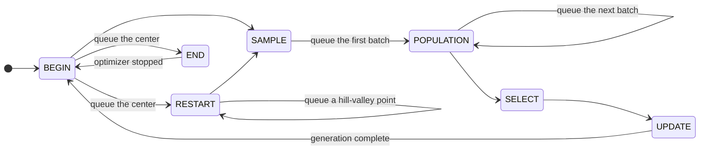

# How modcma is built

This section is for the maintainers of modcma. It explains how the code works, how to change it,
and what to do when a check fails. It assumes that you know CMA-ES. What the modules do is in the
[user guide](../guide/modules.md) and the [deep dives](../deep-dives/index.md); the rules for a
change (tests, golden fixtures, docstrings, changelog) are in [Contributing](../contributing.md).

This page is the map. The topic pages go into depth, each in three parts: *How it works*, *How to
change it* and *When it breaks*.

## The layers

| layer | files | what it owns |
|---|---|---|
| C++ core | `include/`, `src/` | The algorithm and all of its state, the checks of the settings, and saving and loading a state. It does not depend on Python. CMake builds it as the static library `modcma_core`, which the Python extension, the C++ tests (`tests/cpp/`), the benchmark (`bench/`) and the C++ examples (`examples/cpp/`) link. |
| Bindings | `bindings/` | The extension module `modcma.c_maes.cmaescpp`, written with [nanobind](https://nanobind.readthedocs.io). It converts between numpy arrays and Eigen matrices, and between Python callables and C++ functions. It holds the docstrings of the whole API. It adds what only Python needs: pickle, Python subclasses of restart criteria and samplers, and the deprecated names of 1.x. |
| Python package | `modcma/` | What needs a Python library, or is a convenience on top of the C++ API: `fmin`, `settings_from_dict`, `settings_from_config`, `preset`, `get_configspace` (ConfigSpace) and `warm_start`. At import it gives scipy's LAPACK to the C++ core when the extension has none linked (`_use_scipy_lapack`). `modcma/__init__.py` re-exports `modcma.c_maes` and raises an error for the names of the removed pure-Python implementation. `modcma/c_maes/cmaescpp/*.pyi` are the type stubs, generated from the extension. |

Two consequences for debugging:

* **The bindings hold no part of the algorithm**, with one exception: the loop of `run()` and
  `step()` for a vectorized objective (`step_with` in `bindings/parameters.cpp`). It repeats
  `ModularCMAES::step` with `ask()` and `tell()`, so that the objective gets each batch as one
  array. A wrong number comes from the C++ core, or from a conversion in the bindings.
* **The API reference on this site is read from the stubs**, not from the compiled extension. A
  docstring changed in `bindings/` appears there after `python tools/gen_stubs.py`.

## The objects

Three objects make an optimizer, created in this order:

1. **`parameters::Settings`** (`include/settings.hpp`): the configuration, a value type. Its
   constructor fills in the defaults, adjusts combinations of modules that do not fit together, and
   checks every value.
2. **`parameters::Parameters`** (`include/parameters.hpp`): the state of a run. It is built from a
   `Settings`, which it keeps as a copy (`p.settings`). Its constructor turns each option of
   `Modules` into an object, with one factory per module family (the table below).
3. **`ModularCMAES`** (`include/c_maes.hpp`): it holds `std::shared_ptr<Parameters> p` and runs
   the generation. Its own members are the state of the generation in progress (the step that runs
   next, the points that wait for their values) and whether the optimizer has stopped.



A solid arrow is a member. `settings`, `stats`, `weights`, `pop`, `old_pop` and `criteria` are held
by value; the modules and the generator are `std::shared_ptr`s. A dotted arrow means that the
object holds the same generator. Three things follow from this layout:

* **The modules do not point to each other, nor to `Parameters`.** A method that needs another
  module takes `parameters::Parameters &p` as an argument and reaches it through `p`
  (`p.adaptation->m`, `p.mutation->sigma`, `p.pop`). This is how modules share data. Which module
  reads what is therefore visible only at the call sites: search for `p.adaptation` or `p.pop`, not
  for a member.
* **The one object that modules hold together is the random generator** `p.generator`. It is passed
  to the factories of the sampler, of the step-size adaptation (for its sampled step sizes, `ss`)
  and of the bound correction (COTN and UNIFORM_RESAMPLE draw from it). The center placement and
  BIPOP draw from it through `p`. With `Settings.fast_sampling` the sampler seeds a generator of its
  own from it. See [Random numbers](random-numbers.md).
* **A restart replaces some objects and resets others** (`Parameters::finish_restart`). `pop`,
  `old_pop` and `mutation` are new objects. The sampler, the weights, the matrix adaptation and the
  restart criteria are reset in place. The restart strategy and the repelling archive keep their
  state from run to run. A Python reference to `es.p.mutation` taken before a restart still points
  to the old step-size adaptation.

How an option becomes an object (all in the constructor of `Parameters`, `src/parameters.cpp`):

| options of `Modules` | factory | member of `Parameters` |
|---|---|---|
| `sampler`, `sample_transformation`, `orthogonal` | `sampling::get` | `sampler`: a chain of wrappers, base sampler → transformation → `Orthogonal` → `CachedSampler` |
| `matrix_adaptation` | `matrix_adaptation::get` | `adaptation` |
| `ssa`, `threshold_convergence`, `sequential_selection`, `sample_sigma` | `mutation::get` | `mutation`, with its parts `tc`, `sq` and `ss` |
| `elitist`, `mirrored` (PAIRWISE) | `selection::Strategy` | `selection`, with `elitsm` and `pairwise` |
| `restart_strategy` | `restart::strategy::get` | `restart_strategy` |
| `restart_strategy`, `matrix_adaptation`, `repelling_type` | `restart::Criteria::get` | `criteria`, the list `items` |
| `bound_correction` | `bounds::get` | `bounds` |
| `repelling_type` | `repelling::get` | `repelling` |
| `center_placement` | `center::get` | `center_placement` |
| (`Settings.integer_variables`) | `mapping::get` | `coordinate_mapping` |
| `weights` | `parameters::Weights` | `weights`, with the learning rates |

Some options are not objects; the code reads them from `p.settings.modules` where they act:
`mirrored` in `mutation::Strategy::sample_batch`, `active` in the matrix updates,
`repelling_metric` in `repelling::TabooPoint::distance`.

## One generation, end to end

`ModularCMAES::advance()` (`src/c_maes.cpp`) runs the steps of a generation: a `switch` over the
enum `Step`, in a loop. A step that needs objective values queues points (`queue()`) and returns
control. `ask()` hands those points out, and once `tell()` has given all their values, `advance()`
continues at the step in `next`. `advance()` is the only place that queues points, and no module
calls the objective.



Each "queue" waits for `tell()`. After UPDATE and after END, `advance()` returns `true`.

| step | what happens | what it calls |
|---|---|---|
| **BEGIN** | When a stop condition holds (`stop_flags()`: the target, `max_generations`, a restart criterion with `restart_strategy` STOP, or a budget that does not fit the next generation and the final center of mass), the run ends and its center of mass is queued; next END. Otherwise the last population becomes `old_pop` (a swap of the buffers). When a restart criterion is met, the restart strategy gives the step size of the new run (IPOP and BIPOP also a new λ and μ), the run ends, and its center of mass is queued; next RESTART. Otherwise next SAMPLE. | `Parameters::begin_generation`, `restart::Strategy::update`, `Parameters::end_run` |
| **END** | The center of mass has its value: `dispatch` passed it to `Parameters::tell_center_of_mass`, which records the run in `stats.centers`. The optimizer has stopped; `break_conditions()` now holds. | |
| **RESTART** | The value of the center started the update of the repelling archive (`Repelling::begin_update`, which calls `on_restart`). While the archive has a query, its next hill-valley point is queued, one at a time: each depends on the value of the one before (`Repelling::answer`, which calls `on_shared_basin` and, after the last test, `on_update_end`). Then the new run starts. | `Repelling::has_query`, `query_point`; `Parameters::finish_restart`: `fit_lambda_to_budget`, `Sampler::reset`, `Weights::init`, new `pop` and `old_pop`, a new `mutation` (`mutation::get`), `Adaptation::restart` and `start_from` (C0), `center::Placement`, `Criteria::reset` (each criterion's `on_reset`) |
| **SAMPLE** | `begin_population` starts the population: `pop.n` = λ, a new block of orthogonal samples (`Sampler::begin_generation`), the step sizes of the individuals (`pop.S`), the threshold of threshold convergence, `prepare_sampling` of repelling, then the hook `on_population_begin`. The first batch is sampled and queued: all λ individuals, or with sequential selection the individuals up to the first one after which the generation can stop. Then TPA's two points, when this generation has them. | `mutation::Strategy::begin_population`, `sample_batch_from`, `n_extra_points_due`, `extra_points` |
| **POPULATION** | The next batch, until every individual has its value. Only sequential selection has more than one batch. | `mutation::Strategy::sample_batch_from` |
| **SELECT** | Elitism appends the parents, the pool is sorted (with pairwise selection the winners of the mirrored pairs first) and cut to λ. The best solutions and the success of the generation go into `stats`. | `selection::Strategy::select` |
| **UPDATE** | The new mean, then the evolution paths, the step size, the matrix and the restart criteria; `stats.t` increases. The generation is complete. | `Parameters::recombine`; `Parameters::adapt`: `Adaptation::adapt_evolution_paths`, `mutation::Strategy::adapt`, `Adaptation::adapt_matrix`, `Criteria::update` |

**Sampling a batch** (`mutation::Strategy::sample_batch`):

1. `Sampler::sample` writes the z of each individual into `pop.Z` (with mirrored sampling, the
   second of a pair is −z);
2. `Adaptation::compute_y_batch` computes y = A z for the whole batch into `pop.Y`;
3. then, for each individual, threshold convergence may lengthen z and y;
4. x = m + s ∘ y, with the step sizes s of `pop.S`, goes into `pop.X`; `BoundCorrection::correct`
   repairs it;
5. a point that RESAMPLE or the repelling archive rejects is sampled again;
6. `CoordinateMapping::transform_into` rounds the integer variables into `pop.X_transformed`, the
   point that is evaluated. `queue_population_batch` copies these columns into the queue.

**When the values arrive.** `tell(f)` calls `answer()`, then `advance()`:

```cpp
bool ModularCMAES::tell(Eigen::Ref<const Vector> f, const Eigen::Ref<const Matrix> *X)
{
    answer(f, X);
    return advance();
}
```

`answer()` goes through the queued requests in order. For each, it adds the number of points to
`stats.evaluations` (the only place where evaluations are counted) and calls `dispatch()`, a
`switch` over the request's `Source`:

| source | the module that gets the values |
|---|---|
| `POPULATION` | `mutation::Strategy::tell_batch`. A point given to `tell(f, X)` that differs from the asked one replaces it (`Parameters::inject`). The value goes into `pop.f`; sequential selection may end the population here (`pop.n` shrinks). After the last individual, `end_population` calls `adapt_radii_after_sampling` of repelling and the hook `on_population_complete`. |
| `EXTRA_POINTS` | `mutation::Strategy::tell_extra_points` (TPA's two points) |
| `CENTER_OF_MASS` | `Parameters::tell_center_of_mass` |
| `HILL_VALLEY` | `repelling::Repelling::answer` |

**Where the data lives:**

| data | where |
|---|---|
| the points that `ask()` returns | `ModularCMAES::batch`, its first `n_pending` columns; `ModularCMAES::requests` names the source of each range |
| the step that runs next | `ModularCMAES::next` |
| the population: z, y, step sizes, x, the evaluated x, f, generation | `p->pop`: `Z`, `Y`, `S`, `X`, `X_transformed`, `f`, `t`, columns `0` to `pop.n - 1` |
| the previous generation (the parents of elitism; MSR, PSR and sequential selection compare with it) | `p->old_pop` |
| the mean, the previous mean, the paths, the matrix | `p->adaptation`: `m`, `m_old`, `dm`, `ps`, and the members of each adaptation |
| the step size | `p->mutation->sigma` |
| the weights and learning rates | `p->weights` |
| the counters, the best solutions, the record of each finished run | `p->stats`: `t`, `t_run`, `evaluations`, `current_best`, `global_best`, `solutions`, `centers` |

`pop.X_transformed` holds the points that were evaluated: `pop.X` with the integer variables
rounded, or a point given to `tell(f, X)` before its step was clipped (`Parameters::inject`). The
mean is recombined from `pop.X`.

### Ask–tell and `run()`, bit for bit

Every way of running the optimizer goes through `advance()` and `answer()`:

* `step()` calls `ask()`, evaluates the queued points and calls `tell()`, until `tell()` returns
  `true`. `run()` (`operator()`) calls `step()` until a break condition holds.
* `mutate()` of the 1.x API runs `advance()` and `answer()` up to SELECT. `select()`,
  `recombine()` and `adapt()` call the same functions as SELECT and UPDATE.
* From Python, `run()` and `step()` call the C++ ones. A vectorized objective uses `step_with` in
  the bindings, which repeats `step()` with `ask()` and `tell()`.

So the ways differ only in who calls the objective. The results stay identical because:

* random numbers are drawn inside `advance()`, when points are computed and queued, never when
  values arrive: the order of the draws depends only on the steps;
* evaluations are counted in one place, `answer()`, before a module gets the values: every budget
  check sees the same count;
* `tell(f, X)` replaces only the points that differ from the asked ones (an exact comparison in
  `Strategy::tell_batch`), so passing back the asked points changes nothing.

It breaks when one way gets code of its own that changes the state: a module that calls the
objective itself (it can only where the objective is known: `run()`, `step()`, `mutate()`), or work
in `step()` that `ask()` and `tell()` do not do. `python -m tests.golden check --drivers all` runs
every way (the drivers `step`, `asktell`, `asktell_points`, `vectorized` and `steps`) against the
same fixture. See [The generation and ask–tell](generation.md) and [The test tiers](testing.md).

## A map of the files

The core: each header in `include/` with its source in `src/`.

| header | source | contents |
|---|---|---|
| `c_maes.hpp` | `c_maes.cpp` | `ModularCMAES`: the steps of a generation (`advance`), `ask`, `tell`, the stop conditions, the steps of the 1.x API |
| `parameters.hpp` | `parameters.cpp` | `Parameters`: the modules and the state of a run; recombination and adaptation, the end of a run and the restart, the budget (`reserved_points`, `restart_fits`), injected points and gradient injection |
| `settings.hpp` | | `Settings`: the defaults, the adjusted combinations, the checks of every field |
| `modules.hpp` | | The enums of the module options, and `Modules` |
| `common.hpp` | `common.cpp` | `Float`, `Vector`, `Matrix`; `Solution`, `MetricCopy`; the process-wide `constants`; sorting helpers; `rng`: the global generator, `fork`, `set_seed`, `below`, `shuffle`, xoshiro256++ and the ziggurat |
| `population.hpp` | `population.cpp` | `Population`: the columns of a generation, `sort`, `reorder`, `reserve` |
| `stats.hpp` | | `Stats` (counters, best solutions, success rate) and `Center`, the record of a finished run |
| `weights.hpp` | `weights.cpp` | `Weights`: the recombination weights and the learning rates (`cs`, `cc`, `c1`, `cmu`, `damps`, ...) |
| `sampling.hpp` | `sampling.cpp` | The samplers (`Uniform`, `Sobol`, `Halton`, `FastGaussian`, ...), the transformations into other distributions, `Orthogonal`, `CachedSampler`; `sampling::get` |
| `mutation.hpp` | `mutation.cpp` | `mutation::Strategy`: the population in batches, the sampling of a batch, and the step-size adaptations (CSA, TPA, MSR, PSR, the xNES rules, SR, SA, TPA_INPLACE); threshold convergence, sequential selection, sampled step sizes |
| `matrix_adaptation.hpp` | `matrix_adaptation.cpp` | `Adaptation` and its eight variants: the evolution paths, the matrix update, y = A z and z = A⁻¹ y, `Metric` |
| `selection.hpp` | `selection.cpp` | Elitism, pairwise selection and the sort; the best solutions of a generation |
| `restart_criteria.hpp` | `restart_criteria.cpp` | The restart criteria, and `Criteria::get`, which chooses them |
| `restart_strategy.hpp` | `restart_strategy.cpp` | The restart strategies: the base class (RESTART, STOP), IPOP, BIPOP. The header has CRLF line endings |
| `repelling.hpp` | `repelling.cpp` | Repelling restarts: the taboo archive, the rejection of samples, the hill-valley tests at a restart |
| `bounds.hpp` | `bounds.cpp` | The bound corrections; `correct_point` for a single point (TPA's points, gradient injection) |
| `center_placement.hpp` | `center_placement.cpp` | Where a new run starts after a restart |
| `mapping.hpp` | | `CoordinateMapping`: the rounding of the integer variables |
| `serialization.hpp` | `serialization.cpp` | Saving and loading a state (#91, #183): `put` and `make` per class, the type tags of the modules, the format version, the checksum |
| `lapack.hpp` | `lapack.cpp` | LAPACK and BLAS (linked, or scipy's), used from a threshold dimension on |
| `es.hpp` | `es.cpp` | The baselines `OnePlusOneES` and `MuCommaLambdaES` (`modcma.es`), separate from `ModularCMAES` |
| `functions.hpp` | `functions.cpp` | Test functions and a random rotation, for the C++ examples |
| `to_string.hpp` | | The names of the enum values and of `Modules`, for the reprs of the bindings |
| | `ndtr_ndtri.cpp` | The normal CDF and its inverse (`cdf`, `ppf`; from Cephes), for the Gaussian transformation |
| | `sobol.cpp` | The Sobol sequence (`i8_sobol`; John Burkardt's C++ version) |

The bindings, in `bindings/`:

| file | contents |
|---|---|
| `common.hpp` | Shared by all files: the caster that gives a Python objective a new array for each call, `def_pickle`, helpers (`to_bool`, `to_vector`, `repr`, `warn_deprecated`), the restart criteria as an opaque list |
| `module.cpp` | `NB_MODULE(cmaescpp)`: the order in which the submodules are defined; `constants`, `options` (the enums), `set_seed`, `build_info`, `compute_ert`, `_internal` |
| `parameters.cpp` | `Population`, `Modules`, `Settings`, `Weights`, `Stats`, `Solution`, `Center`, `Parameters`, `ModularCMAES` (with the Python loops of `run` and `step`), and the `es` baselines |
| `algorithm.cpp` | The submodules `selection`, `center`, `repelling`, `matrix_adaptation`, `bounds` and `mutation` |
| `restart.cpp` | The submodule `restart`: the criteria, with the trampoline `PyCriterion` for criteria written in Python, and the strategies |
| `sampling.cpp` | The submodule `sampling`: the samplers and transformations, with `PySampler` for a sampler written in Python |

## Where to look for …

| question | page | files |
|---|---|---|
| You add a member to a class, e.g. to CSA. What else changes? | [Saving and resuming runs](serialization.md) | `src/serialization.cpp` |
| A golden run fails in the `resume` drivers only. | [Saving and resuming runs](serialization.md) | `src/serialization.cpp`, `tests/golden.py` |
| A golden run fails in one driver only, e.g. `asktell`. | [The generation and ask–tell](generation.md), [The test tiers](testing.md) | `src/c_maes.cpp`, `tests/golden.py` |
| A module needs objective values of its own (extra points). | [The generation and ask–tell](generation.md) | `include/c_maes.hpp` (`Source`), `src/c_maes.cpp` (`advance`, `dispatch`), `Parameters::reserved_points` |
| Why does `ask()` return more or fewer than λ points? | [The generation and ask–tell](generation.md), [Ask–tell](../getting-started/ask-tell.md) | `src/c_maes.cpp` |
| When is the eigendecomposition, or the inverse of a factor, computed? | [Matrix adaptation internals](matrix-adaptation.md) | `include/matrix_adaptation.hpp`, `src/matrix_adaptation.cpp`, `src/lapack.cpp` |
| The same seed gives other numbers. | [Random numbers](random-numbers.md) | `src/common.cpp` (`rng`), `src/parameters.cpp` (`generator`) |
| Results differ on another platform or compiler. | [Random numbers](random-numbers.md), [The test tiers](testing.md) | `tests/data/golden/` |
| A setting is rejected, or changed without being asked. | [Settings validation](settings-validation.md) | `include/settings.hpp` |
| You add an option to an enum of `Modules`. | [The bindings](bindings.md), [The test tiers](testing.md) | `include/modules.hpp`, the factory of its family, `include/to_string.hpp`, `bindings/module.cpp`, `modcma/c_maes/__init__.py` (`get_configspace`) |
| A stub, docstring or API test fails. | [The bindings](bindings.md) | `bindings/`, `tools/gen_stubs.py`, `tests/api_dump.py` |
| A branch changes results. Is it better or worse? | [The test tiers](testing.md) | `tests/statistical.py` |
| CI fails, or a release is due. | [CI and the release](ci-release.md) | `.github/workflows/` |
| Why is a line as it is? A comment cites #123, F2 or WP3. | [Where the history is](history.md) | `dev/overhaul-2.0.md`, `CHANGELOG.md` |
