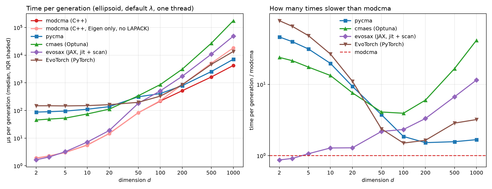
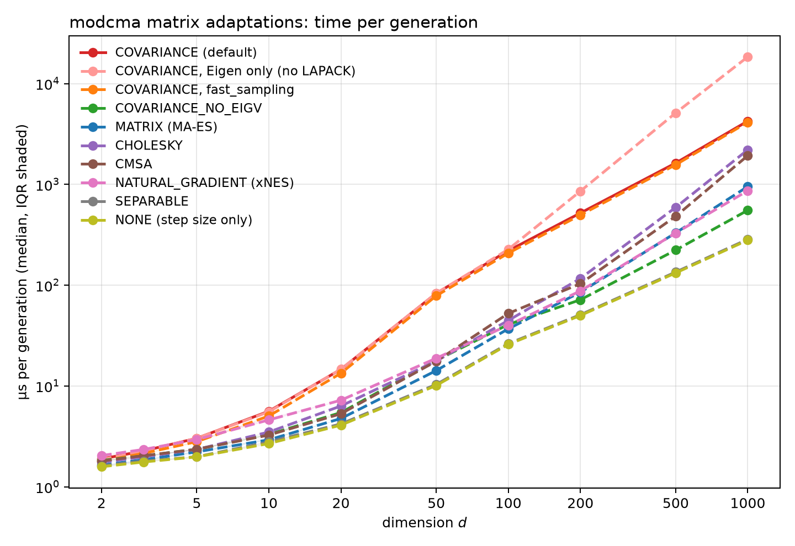
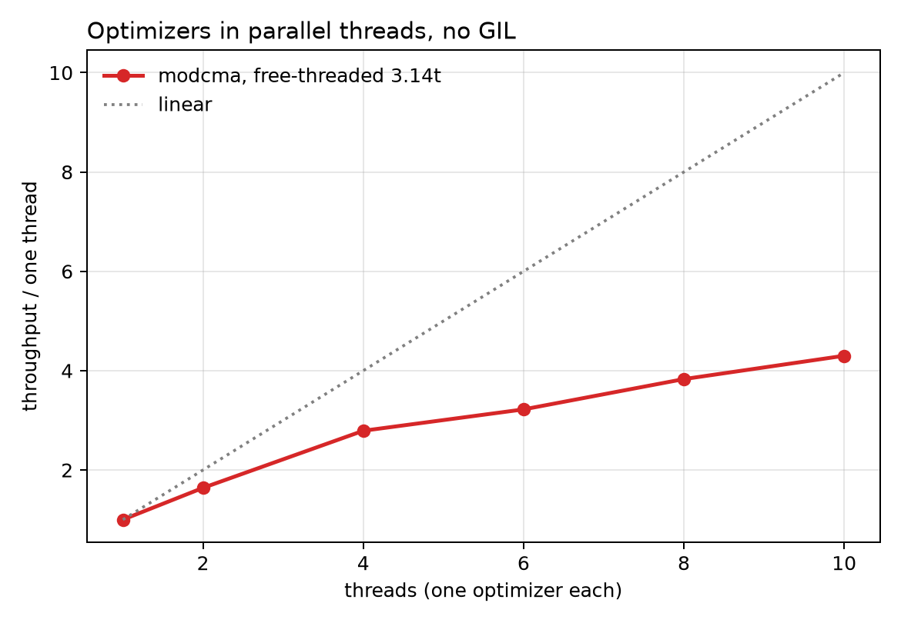

# Performance

How fast is ModularCMAES compared with other CMA-ES implementations, and how do its matrix
adaptations scale with the dimension?

**In short.** ModularCMAES runs a CMA-ES generation faster than pycma, `cmaes` (the implementation
in Optuna), evosax and EvoTorch at every dimension from 10 to 1000, and level with the fastest
below:

* up to d = 10: **20–46× faster than pycma**, **13–24× faster than `cmaes`**, **27–78× faster than
  EvoTorch**; level with evosax, even when evosax compiles the *entire* run into one XLA program;
* at d = 100: 1.5–3.9× faster than each of them; at d = 1000: 1.7× faster than pycma, 3.2× than
  EvoTorch, 12× than evosax and 42× than `cmaes`, with LAPACK and BLAS for the linear algebra in
  high dimension (Apple Accelerate on macOS, scipy's LAPACK/BLAS on Linux and Windows; see
  [LAPACK and BLAS](#lapack-and-blas-in-high-dimension));
* the matrix adaptations without an eigendecomposition (MA-ES, xNES, Cholesky-CMA-ES, …) are
  another 2–8× faster at d = 1000;
* on free-threaded Python, independent optimizers run in parallel threads.



## Contents

- [Setup](#setup)
- [CMA-ES implementations](#cma-es-implementations)
- [LAPACK and BLAS in high dimension](#lapack-and-blas-in-high-dimension)
- [ModularCMAES matrix adaptations](#modularcmaes-matrix-adaptations)
- [Python objectives: vectorized and ask–tell](#python-objectives-vectorized-and-asktell)
- [Parallel threads](#parallel-threads)
- [Where the speed comes from](#where-the-speed-comes-from)
- [Limits](#limits)
- [Reproducing](#reproducing)

## Setup

| | |
|---|---|
| Machine | Apple M5 (4 performance + 6 efficiency cores), 16 GB, macOS 27 |
| Python | 3.13.15; free-threaded 3.14.7t for [threads](#parallel-threads) |
| Versions | modcma (this repository; LAPACK: Accelerate), pycma 4.6.0, cmaes 0.13.1, evosax 0.3.2 (JAX 0.12.1), EvoTorch 0.6.1 (PyTorch 2.15.0), numpy 2.5.5 |
| Problem | separable ellipsoid f(x) = Σᵢ 10^(6(i−1)/(d−1)) xᵢ², d = 2 … 1000 |
| Algorithm | each library's full-covariance CMA-ES: population size λ = 4 + ⌊3 ln d⌋, σ₀ = 2, m₀ = 0, no restarts, no active update |
| Measurement | wall time of a fixed number of generations (1000 for d ≤ 100, 200 above), median of 15 runs (5 above d = 100), IQR shaded in the figures |
| Threads | one: BLAS/LAPACK (Accelerate), OpenMP, XLA and torch are limited to one thread, so the comparison is between implementations, not thread pools |

Every library evaluates the whole population with one call to the same ellipsoid, written for its own
array type (numpy, JAX, torch). Evaluating it costs well under a microsecond per point, so the time
per generation is the algorithm: sampling, selection and the updates of the mean, step size and
covariance matrix, plus the library's overhead per generation. Each library is driven the way its
documentation recommends:

| | how it is run |
|---|---|
| modcma | `ModularCMAES.run(f, vectorized=True)`: the loop runs in C++, one Python call per generation |
| pycma | `ask()` / `tell()` |
| cmaes | `ask()` once per solution, `tell()` (its interface) |
| evosax | `ask` / `tell` of `CMA_ES`, the **whole run** compiled with `jax.jit` + `jax.lax.scan` (compilation excluded): JAX's best case |
| EvoTorch | `CMAES.step()` on a vectorized `Problem` |

## CMA-ES implementations

Time per generation (median):

| implementation | d=2 | d=10 | d=50 | d=100 | d=200 | d=500 | d=1000 |
|---|---|---|---|---|---|---|---|
| **modcma** | **1.9 µs** | **5.6 µs** | **83 µs** | **220 µs** | **520 µs** | **1.6 ms** | **4.2 ms** |
| modcma, Eigen only (no LAPACK/BLAS) | 1.9 µs | 5.5 µs | 83 µs | 227 µs | 857 µs | 5.1 ms | 18.4 ms |
| pycma | 87 µs | 111 µs | 312 µs | 409 µs | 792 µs | 2.6 ms | 7.1 ms |
| cmaes (Optuna) | 45 µs | 75 µs | 340 µs | 865 µs | 3.1 ms | 27.1 ms | 176.8 ms |
| evosax (JAX, jit + scan) | 1.6 µs | 7.2 µs | 182 µs | 512 µs | 1.7 ms | 10.9 ms | 48.9 ms |
| EvoTorch (PyTorch) | 148 µs | 150 µs | 197 µs | 330 µs | 855 µs | 4.7 ms | 13.6 ms |

How many times longer each library takes than modcma (with LAPACK; above 1: modcma is faster):

| | d=2 | d=10 | d=50 | d=100 | d=200 | d=500 | d=1000 |
|---|---|---|---|---|---|---|---|
| pycma | 46× | 20× | 3.8× | 1.9× | 1.5× | 1.6× | 1.7× |
| cmaes (Optuna) | 24× | 13× | 4.1× | 3.9× | 6.0× | 17× | 42× |
| evosax (JAX, jit + scan) | 0.9× | 1.3× | 2.2× | 2.3× | 3.3× | 6.7× | 12× |
| EvoTorch (PyTorch) | 78× | 27× | 2.4× | 1.5× | 1.6× | 2.9× | 3.2× |

* In low dimension the Python libraries pay a fixed overhead per generation: about 85 µs for pycma,
  45 µs for cmaes and 145 µs for EvoTorch, which is more than a whole modcma generation up to d ≈ 20.
  A run of 10 000 generations at d = 10 takes 0.06 s with modcma and 1.1 s with pycma.
* evosax only matches modcma when the objective is itself written in JAX and the whole run is one
  compiled program. With an objective outside JAX (a simulator, a Python function) every generation
  goes back to the host, and evosax pays its per-call overhead like the other Python libraries.
  modcma has no compilation step and the same speed for any objective.
* evosax and `cmaes` decompose the covariance matrix every generation; modcma and pycma only every
  few generations (every 3rd at d = 200, every 9th at d = 1000). This is part of the difference in
  high dimension.

## LAPACK and BLAS in high dimension

Above d ≈ 100 the default covariance update is dominated by the eigendecomposition. Eigen's
`SelfAdjointEigenSolver` is unblocked: at d = 1000 one decomposition takes about 165 ms, against
48 ms for LAPACK's `dsyevd` (Apple Accelerate, one thread), which pycma calls through numpy.
modcma therefore uses `dsyevd` from d = 120 on; below, Eigen is faster on these runs (the
covariance matrix of the separable ellipsoid stays nearly diagonal, where Eigen's QL iteration
converges quickly). The C++ benchmark, µs per generation:

| eigendecomposition | d=50 | d=100 | d=200 | d=500 | d=1000 |
|---|---|---|---|---|---|
| Eigen `SelfAdjointEigenSolver` | **85** | **226** | 874 | 5 288 | 18 641 |
| LAPACK `dsyevd` (divide and conquer) | 163 | 249 | **582** | **1 992** | **5 468** |
| LAPACK `dsyevr` (MRRR) | 176 | 303 | 765 | 4 363 | 15 448 |

Where LAPACK comes from:

* **macOS**: the library links Apple Accelerate, part of the system (no extra size).
* **Linux and Windows**: the wheels have no LAPACK of their own; at import, `modcma.c_maes` hands
  the C++ library the LAPACK routines of scipy (`scipy.linalg.cython_lapack`), a dependency of
  modcma that it imports anyway. That is OpenBLAS in scipy's wheels, MKL in some conda builds. In a
  single-threaded measurement OpenBLAS's `dsyevd` is as fast as Accelerate's (d = 1000: 57 ms,
  Eigen 289 ms on random matrices, Apple M5). OpenBLAS uses all cores by default, which was
  slower here (83 ms) and competes with optimizers running in parallel: set
  `OPENBLAS_NUM_THREADS=1` (or use `threadpoolctl`) when running many optimizers at once.
* **C++ programs**: CMake option `MODCMA_LAPACK` (on by default on macOS) links a LAPACK
  (`find_package(LAPACK)`); without it, Eigen only.

The same holds for the Cholesky factorization of CMSA and `COVARIANCE_NO_EIGV`: Eigen's LLT is
blocked, but LAPACK's `dpotrf` is still faster from d ≈ 100 (one factorization, one thread):

| Cholesky factorization | d=50 | d=100 | d=200 | d=500 | d=1000 |
|---|---|---|---|---|---|
| Eigen `LLT` | **0.010 ms** | 0.030 ms | 0.122 ms | 1.10 ms | 7.38 ms |
| LAPACK `dpotrf`, Accelerate | 0.029 ms | **0.016 ms** | **0.034 ms** | **0.20 ms** | **1.01 ms** |
| LAPACK `dpotrf`, OpenBLAS | 0.018 ms | 0.028 ms | 0.104 ms | 0.49 ms | 2.18 ms |

With it, a CMSA generation at d = 1000 took 2.4 ms instead of 9.1 ms, and `COVARIANCE_NO_EIGV`
1.0 ms instead of 1.7 ms (before the BLAS products below) (`constants.cholesky_solver`: -1 automatic, 0 Eigen, 1 LAPACK).

**Matrix products and the inverse.** The rest of the linear algebra in high dimension is matrix
products: sampling a batch (`Y = A·Z`, also for the triangular factors) and the updates of MA-ES
and xNES. From d = 100 on they use BLAS `dgemm` (also for the triangular factors: OpenBLAS's `dtrmm`
is slower than Eigen up to d ≈ 200). MA-ES and xNES also need the inverse of M (A) after
an update whenever `invert_y` is used (bound correction, elitism, repelling): it was a
pseudo-inverse (complete orthogonal decomposition), now an LU inverse (`dgetrf`, `dgetri`), with the
pseudo-inverse as the fallback when M is singular. One operation, one thread, d = 1000 (λ = 24):

| | Eigen | Accelerate | OpenBLAS |
|---|---|---|---|
| `Y = A·Z` | 1.13 ms | 0.095 ms | 0.104 ms |
| inverse of M | 150 ms (pseudo-inverse) | 6.5 ms | 14.9 ms |

The rank updates of the covariance matrices (COVARIANCE, CMSA, the natural gradient of xNES) stay
with Eigen at every dimension. With only λ columns they are bound by the passes over the d × d
matrix, not by the arithmetic: Eigen's `rankUpdate` writes the lower triangle once (0.60 ms at
d = 1000, λ = 24), while a `dgemm` on the whole matrix plus the decay and the mirroring to the
upper triangle takes 1.0 ms. Done with `dgemm`, they made whole generations slower at every
dimension (CMSA at d = 1000: 2.4 ms instead of 1.9 ms) and caused the slowdown at d = 50 that
first set the threshold. Without them, BLAS breaks even at d ≈ 50–75 (below, each small product is
slower through Accelerate than in Eigen; the call itself costs 20–50 ns), and is used from
`constants.blas_min_dim` = 100. Per generation, Eigen-only products → BLAS: MA-ES d = 1000
2.3 → 0.95 ms, xNES 2.8 → 0.87 ms, CMSA 2.4 → 1.9 ms, `COVARIANCE_NO_EIGV` 1.0 → 0.55 ms, the
default 5.4 → 4.2 ms; unchanged up to d = 50.

The decompositions are the same (eigenvalues to 1e-12 relative, `tests/cpp/test_main.cpp`,
`tests/test_c_lapack.py`), and the optimizer converges alike (ellipsoid, d = 130, 1e-8: 956 000–
997 000 evaluations with either). The results are not bit-identical to Eigen's and depend on the
LAPACK, so the choice is visible and adjustable:

```python
from modcma import c_maes
c_maes.utils.build_info()["lapack"]   # "linked" (macOS), "scipy" (Linux, Windows) or "none"
c_maes.constants.eigen_solver         # -1 automatic (default), 0 Eigen, 1 dsyevd, 2 dsyevr
c_maes.constants.cholesky_solver      # -1 automatic (default), 0 Eigen, 1 dpotrf
c_maes.constants.lapack_min_dim       # 120: eigendecomposition and Cholesky use LAPACK from here on
c_maes.constants.blas                 # -1 automatic (default), 0 Eigen, 1 BLAS: products, LU inverse
c_maes.constants.blas_min_dim         # 100: products and the inverse use BLAS/LAPACK from here on
```

## ModularCMAES matrix adaptations



| matrix adaptation | d=2 | d=10 | d=50 | d=100 | d=200 | d=500 | d=1000 |
|---|---|---|---|---|---|---|---|
| COVARIANCE (default) | 1.9 µs | 5.6 µs | 83 µs | 220 µs | 520 µs | 1.6 ms | 4.2 ms |
| COVARIANCE, Eigen only (no LAPACK/BLAS) | 1.9 µs | 5.5 µs | 83 µs | 227 µs | 857 µs | 5.1 ms | 18.4 ms |
| COVARIANCE, fast_sampling | 1.8 µs | 5.0 µs | 79 µs | 208 µs | 497 µs | 1.6 ms | 4.1 ms |
| COVARIANCE_NO_EIGV | 1.8 µs | 3.3 µs | 18 µs | 41 µs | 72 µs | 223 µs | 554 µs |
| MATRIX (MA-ES) | 1.6 µs | 2.9 µs | 14 µs | 37 µs | 85 µs | 330 µs | 953 µs |
| CHOLESKY | 1.8 µs | 3.5 µs | 18 µs | 45 µs | 117 µs | 592 µs | 2.2 ms |
| CMSA | 1.8 µs | 3.3 µs | 18 µs | 52 µs | 104 µs | 483 µs | 1.9 ms |
| NATURAL_GRADIENT (xNES) | 2.0 µs | 4.6 µs | 19 µs | 40 µs | 88 µs | 329 µs | 866 µs |
| SEPARABLE | 1.6 µs | 2.8 µs | 10 µs | 26 µs | 51 µs | 135 µs | 285 µs |
| NONE (step size only) | 1.6 µs | 2.7 µs | 10 µs | 26 µs | 50 µs | 132 µs | 280 µs |

* The cost per generation follows the update: O(d²λ) for MA-ES, Cholesky-CMA-ES and xNES
  (`NATURAL_GRADIENT`, see below); O(d³) for the eigendecomposition of the default and the Cholesky
  factorization of `COVARIANCE_NO_EIGV` (both amortized over several generations) and the Cholesky
  factorization of CMSA (every generation), all with LAPACK from d = 120; O(dλ) for `SEPARABLE` and
  `NONE`.
* **xNES with a low-rank matrix exponential.** The xNES update A ← A·expm(η G) used a dense
  d × d matrix exponential every generation (224.6 ms at d = 1000). G = Z diag(u) Zᵀ − α I has
  rank λ plus a multiple of I, so with a thin QR Z = Q R and the eigendecomposition of the
  small λ × λ matrix R diag(u) Rᵀ = V diag(ℓ) Vᵀ, expm(η G) = e^(−ηα) (I + U diag(expm1(η ℓ)) Uᵀ)
  with U = Q V: exact, O(d²λ). It is used for λ < d and d ≥ 16 (below, the dense exponential is
  cheaper and gives bit-identical results to before): **80× faster at d = 1000, 6× at d = 100**,
  the same trajectories up to rounding (statistically indistinguishable on BBOB; equal to the dense
  exponential to 1e-10 in `tests/cpp/test_main.cpp`). The d < 16 rows above are from the main run;
  the d ≥ 20 rows were measured after this change.
* MA-ES, Cholesky-CMA-ES, `COVARIANCE_NO_EIGV`, CMSA and xNES are level with the fastest other
  implementation (evosax) at d ≤ 3 and faster than every other implementation from d = 5 to
  d = 1000 (MA-ES at d = 5: 2.2 µs against 3.2 µs), where they are **3–13× faster than pycma**
  (0.55–2.2 ms vs 7.1 ms). They are different algorithms, though, not a faster default.
* `fast_sampling` (xoshiro256++ and a ziggurat instead of mt19937 and the inverse normal CDF; a
  different random stream, so off by default) saves up to 10 % here; for the cheap adaptations, where
  sampling dominates, it halves the time (the [C++ benchmark](https://github.com/IOHprofiler/ModularCMAES/blob/master/bench/bench.cpp): `SEPARABLE`,
  d = 100, 19.9 → 10.2 µs per generation).

## Python objectives: vectorized and ask–tell

A Python objective is called by C++ once per point, unless it takes the whole population:

```python
import numpy as np
import modcma

cma = modcma.ModularCMAES(modcma.Settings(10, seed=1))
cma.run(lambda X: np.sum(X**2, axis=1), vectorized=True)   # X is (λ, d)
```

| objective | d=2 | d=10 | d=50 | d=100 | d=200 | d=500 | d=1000 |
|---|---|---|---|---|---|---|---|
| vectorized (one call per generation) | **1.9 µs** | **5.6 µs** | **83 µs** | **220 µs** | **520 µs** | **1.6 ms** | **4.2 ms** |
| one call per point | 5.7 µs | 13 µs | 94 µs | 232 µs | 539 µs | 1.7 ms | 4.4 ms |

Vectorized evaluation is 2–3× faster in low dimension, where the Python call (about 0.6 µs per
point) is most of the work. The same holds for the ask–tell interface (`ask()` returns the
population as a `(λ, d)` array, `tell(f)` takes the values): an objective evaluated outside the
optimizer, in parallel or on another machine, costs one round trip per generation, and the results
are bit-identical to `run()`.

## Parallel threads

Every optimizer has its own random generator, and the extension does not re-enable the GIL on
free-threaded CPython (3.14t). Independent optimizers can therefore run in parallel threads of one
process (here d = 10, ellipsoid, one optimizer per thread):



| threads | generations/s | speed-up |
|---|---|---|
| 1 | 175,755 | 1.00× |
| 2 | 288,637 | 1.64× |
| 4 | 491,025 | 2.79× |
| 6 | 566,334 | 3.22× |
| 8 | 673,441 | 3.83× |
| 10 | 756,239 | 4.30× |

With the GIL (regular CPython 3.14) the same 10 threads reach 1.00×. The M5 has 4 performance and
6 efficiency cores, so the curve flattens after 4 threads.

## Where the speed comes from

* **No allocation per sample.** The population lives in preallocated buffers; sampling, selection,
  recombination and the updates write into them. 0.05–0.15 heap allocations per evaluation remain
  (13–25 before).
* **Matrix products instead of loops.** A generation is sampled as one product Y = A·Z; the
  covariance matrix gets symmetric rank updates on its lower triangle; `C^-1/2` is never formed.
* **LAPACK and BLAS where they pay off**: the eigendecomposition, Cholesky factorizations, matrix
  products and the inverse in high dimension.
* **One crossing per generation.** With a vectorized objective or ask–tell, Python is called once
  per generation, not once per point; bindings with nanobind.
* **Lazy eigendecomposition**, as in pycma: C is decomposed only every few generations.

The C++ benchmark ([`bench/bench.cpp`](https://github.com/IOHprofiler/ModularCMAES/blob/master/bench/bench.cpp), `modcma_bench`) measures the phases of a
generation without Python.

## Limits

* **LAPACK and BLAS on Linux and Windows are scipy's.** Their speed depends on how scipy was built
  (OpenBLAS, MKL), and so do the last bits of the results from d = 100 on. Without them (a C++
  program built without `MODCMA_LAPACK`), the covariance update is slower than pycma from d ≈ 200
  on (the "Eigen only" rows). The numbers here are for Apple Accelerate; the thresholds (100, 120)
  are measured with it.
* **One thread per optimizer.** modcma does not parallelize the linear algebra of a single
  optimizer; numpy, JAX and torch can use several threads for large matrices, which would favour them
  at d ≥ 500 on a machine with idle cores.
* **Time per generation, not time to solution.** All libraries implement CMA-ES with slightly
  different defaults (learning rates, weights, eigendecomposition interval). This document measures
  cost, not convergence; for convergence see the
  [BBOB comparison](https://github.com/IOHprofiler/ModularCMAES/blob/master/scripts/matrix/bbob_matrix_adaptation.png).

## Reproducing

```bash
python -m venv .venv-bench && source .venv-bench/bin/activate
python -m pip install . -r scripts/performance/requirements.txt
python scripts/performance/benchmark.py probe                  # estimate (seconds)
python scripts/performance/benchmark.py run                    # ~15 minutes on the M5
python3.14t scripts/performance/threads.py                     # free-threaded CPython, modcma installed
python scripts/performance/plot.py                             # figures and results/tables.md
```

Run it on an otherwise idle machine. The raw numbers, with the library versions and the machine of
every run, are in [`scripts/performance/results/`](https://github.com/IOHprofiler/ModularCMAES/blob/master/scripts/performance/results/).
